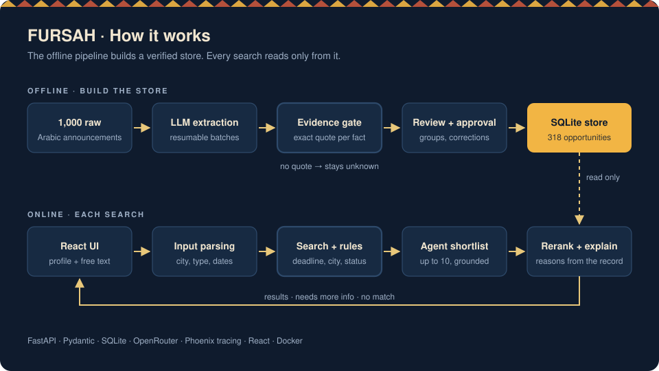
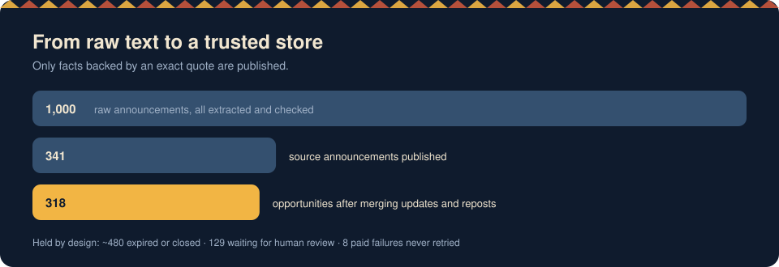
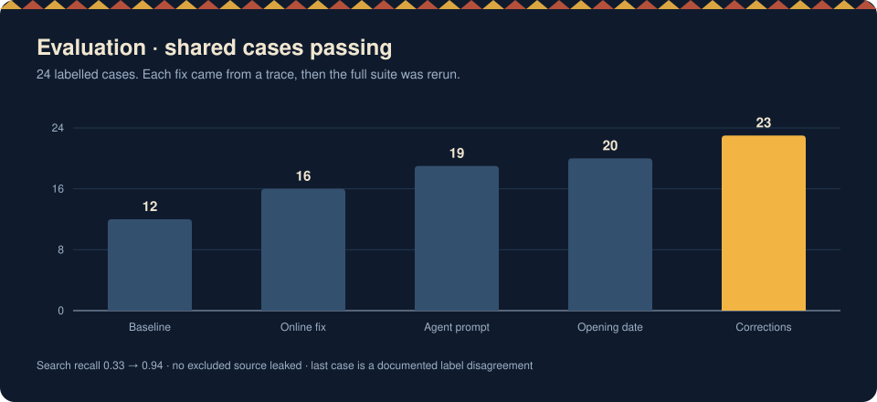

**English** | [العربية](README.ar.md)

# FURSAH · فرصة

**An AI agent that finds the right opportunity for you in Arabic: courses, internships, workshops, volunteering, competitions and events. Every answer is grounded in the original announcement.**

Built by Group 4 (team *Fursatech*) in the **SAAI** applied AI program, October 2026.

> **About the code:** the program does not allow the full source code to be published. This repository describes the project, the design decisions and my role in it. I'm happy to walk through the code in an interview.

---

## The problem

Opportunity announcements in Saudi Arabia are scattered, written in free Arabic text, and often repeated, updated or cancelled. A student who asks *"Is there a design workshop in Jeddah next month?"* has to read dozens of posts and still might miss that registration closed yesterday.

FURSAH takes a user profile (city, interests, budget) and a free-text question. It returns a short list of opportunities that are **still open**, with the **reason** each one fits, and a **link to the source** for every fact.

## Main rule: never invent a fact

LLMs make things up easily, so FURSAH works in two stages:

1. **Offline:** an LLM extracts structured facts from each announcement. A fact is kept only if it comes with an **exact quote** from the source text. Anything the gate cannot verify stays `unknown` and is held for human review.
2. **Online:** the search uses only the approved, verified store. Deterministic rules (deadline, city, registration status) filter the results before the model sees them, and the model can only recommend candidates the search actually returned.

## Results

| Metric | Baseline | Final |
|---|---|---|
| Shared test cases passing | 12 / 24 | **23 / 24** |
| Search recall | 0.33 | **0.94** |
| Excluded sources leaked | 0 | **0** |
| Recommendations grounded in search results | 100% | **100%** |
| Backend unit tests | — | **423 passing** |

The remaining case is a **documented label disagreement**: the label expects an *event*, but the source text describes an internship. We kept the type the text supports instead of bending the system to fit the label.

## My role · Hamed Alharbi

I owned the **data and publication pipeline**, the **search layer**, and the team's **evaluation and fixes**. I also reviewed and merged the team's pull requests.

**Data pipeline**
- Built **resumable extraction batches** over all 1,000 announcements, with offline rechecks so failed items are never sent to the paid API again.
- Built the **import with explicit approval**: every write to the store needs a reviewed plan, takes a backup first, and can be safely re-run.
- Wrote audited **correction rounds** (deterministic fixes, no model calls), for example resolving a repeated title from its unique reference line, and treating a temporary pause as unknown instead of closed.
- Grouped **updates, reposts and reminders** of the same opportunity into one record (24 groups).
- **Froze the final data release** (318 opportunities) with a checksum and documented counts.

**Search and business rules**
- Implemented the **approved-opportunity search** and connected it to the agent workflow.
- Made the **profile city a mandatory constraint**: a conflicting search city returns *"needs more info"* without calling the model.
- Fixed date logic: a deadline before today (Riyadh time) is passed, and a registration whose stated opening date has passed is published with a warning.

**Evaluation (Day 4)**
- Wrote the **graders** for each component (status, recall, excluded sources, grounding, rerank) and the team's own test cases.
- Used **Phoenix traces** to diagnose every failing case, fixed the root cause, and reran the full suite. Results went from 12 to 23 of 24 cases passing with no new failures.

## Tech stack

| Layer | Tools |
|---|---|
| API | Python 3.12, FastAPI, Pydantic v2 |
| Storage | SQLite with versioned migrations |
| LLM | OpenAI SDK via OpenRouter (extraction, shortlist, rerank, explanations) |
| Observability | OpenTelemetry + Arize Phoenix |
| Testing | unittest (423 tests), custom graders and evaluation runner |
| Frontend | React + TypeScript + Vite (provided by the program) |
| Deployment | Docker |

## What I learned

- **Trust comes from the data, not the prompt.** Most failures were data or rule bugs (an online activity with no city, "مكة" vs "مكة المكرمة", a date one day off), not model errors.
- **"Unknown" is a valid answer.** Keeping unverified facts unknown made the system safer and easier to debug.
- **Measure before fixing.** Graders and traces turned "the search feels wrong" into a specific case, span and line.

## Team

Group 4 · *Fursatech*: five members. The raw dataset (1,000 fictional announcements), the frontend and the API shell were provided by SAAI.
